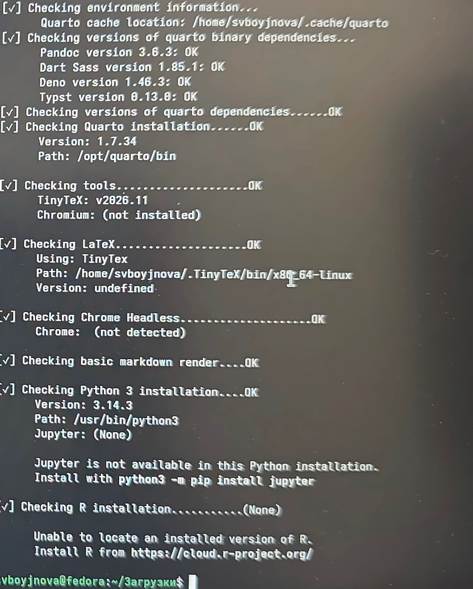

В отчёте представлены результаты выполнения лабораторной работы № 3 по дисциплине «Архитектура компьютера». Подготовлены отчёты в форматах docx и pdf, а также выполнено задание для самостоятельной работы.

# Цель работы

Целью данной работы является приобретение практических навыков оформления отчётов с помощью легковесного языка разметки Markdown.

# Установка необходимого программного обеспечения

Для начала устанавливаю все необходимые программы (Quarto, TinyTeX). 

# Задание для самостоятельной работы

Отчёт по лабораторной работе № 2 подготовлен в трёх форматах (pdf, docx, md), все файлы загружены на GitHub.

# Вывод

В ходе лабораторной работы освоена процедура оформления отчётов с помощью языка разметки Markdown. Установлены и настроены Quarto и TinyTeX. Таким образом, приобретены практические навыки оформления отчётов в Markdown и работы с системой контроля версий.

