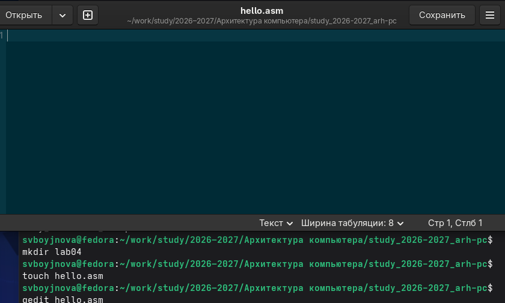
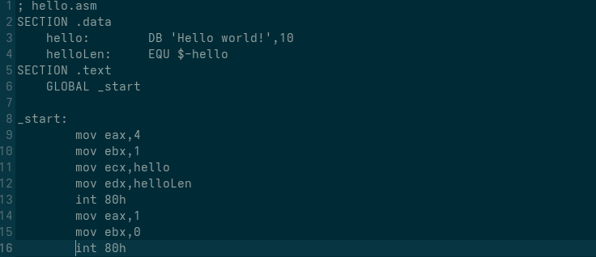
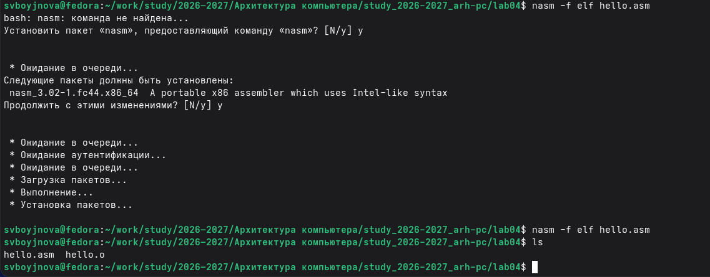
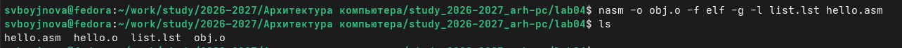
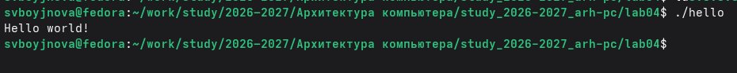
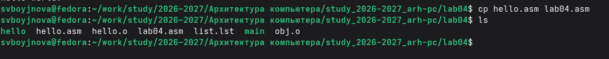
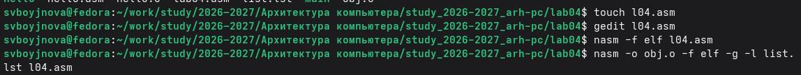
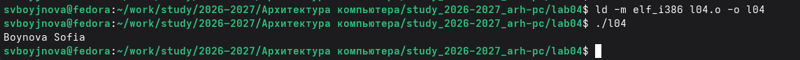

# 1. Цель работы.
Целью данной работы является приобретение практических навыков компиляции и сборки программ, написанных на ассемблере NASM.
# 2. Теоретическое введение
Основными функциональными элементами любой электронно-вычислительной
машины (ЭВМ) являются центральный процессор, память и периферийные
устройства.
Взаимодействие этих устройств осуществляется через общую шину, к которой
они подключены. Физически шина представляет собой большое количество проводников, соединяющих устройства друг с другом. В современных компьютерах проводники выполнены в виде электропроводящих дорожек на материнской (системной) плате.
Основной задачей процессора является обработка информации, а также организация координации всех узлов компьютера. В состав центрального процессора
(ЦП) входят следующие устройства:арифметико-логическое устройство (АЛУ), устройство управления (УУ),регистры.
Для того чтобы писать программы на ассемблере, необходимо знать, какие регистры процессора существуют и как их можно использовать. Большинство командв программах, написанных на ассемблере, используют регистры в качестве операндов. Практически все команды представляют собой преобразование данных, хранящихся в регистрах процессора. Это, например, пересылка данных между регистрами или между регистрами и памятью, преобразование (арифметические или логические операции) данных, хранящихся в регистрах.Доступ к регистрам осуществляется не по адресам, как к основной памяти, а по именам. Каждый регистр процессора архитектуры x86 имеет свое название, состоящее из 2 или 3 букв латинского алфавита. В качестве примера приведем названия основных регистров общего назначения (именно эти регистры чаще всего используются при написании программ): - RAX, RCX, RDX, RBX, RSI, RDI — 64-битные - EAX, ECX, EDX, EBX, ESI, EDI — 32-битные - AX, CX, DX, BX, SI, DI — 16-битные - AH, AL, CH, CL, DH, DL, BH, BL — 8-битные.Другим важным узлом ЭВМ является оперативное запоминающее устройство (ОЗУ). ОЗУ — это быстродействующее энергозависимое запоминающее устройство, которое напрямую взаимодействует с узлами процессора, предназначенное для хранения программ и данных, с которыми процессор непосредственно работает в текущий момент. ОЗУ состоит из одинаковых пронумерованных ячеек памяти. Номер ячейки памяти — это адрес хранящихся в ней данных. Периферийные устройства в составе ЭВМ: - устройства внешней памяти, которые предназначены для долговременного хранения больших объёмов данных. - устройства ввода-вывода, которые обеспечивают взаимодействие ЦП с внешней средой. В основе вычислительного процесса ЭВМ лежит принцип программного
управления. Это означает, что компьютер решает поставленную задачу как
последовательность действий, записанных в виде программы. Коды команд представляют собой многоразрядные двоичные комбинации из 0 и
1 В коде машинной команды можно выделить две части: операционную и адресную.
В операционной части хранится код команды, которую необходимо выполнить. В адресной части хранятся данные или адреса данных, которые участвуют в
выполнении данной операции. При выполнении каждой команды процессор
выполняет определённую последовательность стандартных действий, которая
называется командным циклом процессора. Он заключается в следующем: 1
формирование адреса в памяти очередной команды; 2 считывание кода команды из памяти и её дешифрация; 3 выполнение команды; 4 переход к следующей команде.
 Язык ассемблера (assembly language, сокращённо asm)—машинноориентированный язык низкого уровня. NASM — это открытый проект ассемблера, версии которого доступны под различные операционные системы и который позволяет получать объектные файлы для этих систем. В NASM используется Intel-синтаксис и поддерживаются инструкции x86-64.
 

# 3. Задания
1 Создание программы Hello world!
2 Работа с транслятором NASM
3 Работа с расширенным синтаксисом командной строки NASM
4 Работа с компоновщиком LD
5 Запуск исполняемого файла
6 Выполнение заданий для самостоятельной
## 3.1 Создание программы Hello world!
В создаю каталог, в котором буду хранить файлы для текущей лабораторной работы.
Создаю в нем файл hello.asm, в котором буду писать программу на языке
ассемблера.

Пишу программу в созданном файле.

## 3.2 Работа с транслятором NASM
Компилирую с помощью NASM свою программу.

## 3.3 Работа с расширенным синтаксисом командной строки NASM
Kоманда скомпилирует исходный файл hello.asm в obj.o (опция -o позволяет задать имя объектного файла, в данном случае obj.o), при этом формат выходного файла будет elf и в него будут включены символы для отладки (опция-g), кроме того, будет создан файл листинга list.lst (опция -l). 

## 3.4 Работа с компоновщиком LD
Затем мне необходимо передать объектный файл компоновщику, делаю это с
помощью команды ld.

## 3.5 Запуск исполняемого файла
Всё получилось. Программа вывела то что нам нужно.

# 4. Выполнение заданий для самостоятельной работы.

# 5. Вывод
При выполнении данной лабораторной работы я освоила процедуры компиляции и сборки программ, написанных на ассемблере NASM.

