# Цель работы 
Целью данной работы является приобретение практических составления программ, написанных на ассемблере NASM.
# Теоретическое введение
Midnight Commander (или просто mc) — это программа, которая позволяет просматривать структуру каталогов и выполнять основные операции по управлению файловой системой, т.е. mc является файловым менеджером. Midnight Commander позволяет сделать работу с файлами более удобной и наглядной.
Для активации оболочки Midnight Commander достаточно ввести в командной строке mc и нажать клавишу Enter.
В Midnight Commander используются функциональные клавиши F1—F10, к которым привязаны часто выполняемые операции.
# Выполнение лабораторной работы
Откроем Midnight Commander, перейдём в каталог, далее создадим папку lab05 (Рис.1) , перейдём в него и с помощью команды touch создадим файл lab5-1.asm. 
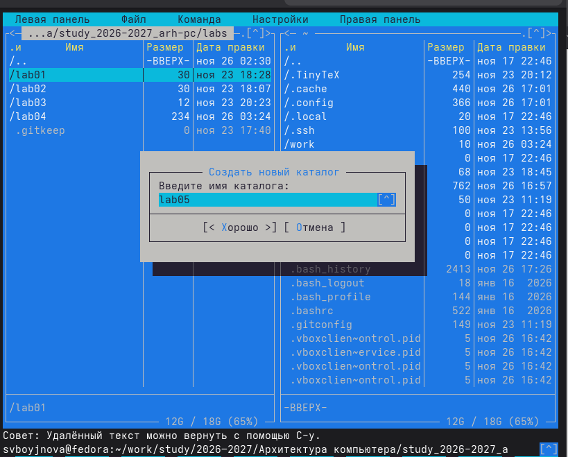
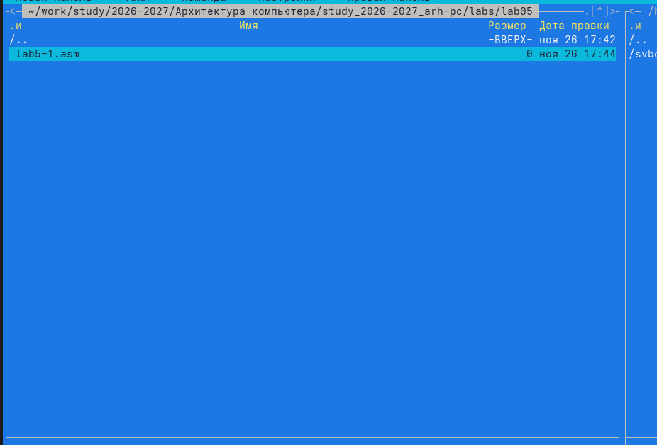
Клавишей F4 файл открыт во встроенном редакторе (mcedit), введён текст программы из листинга 5.1
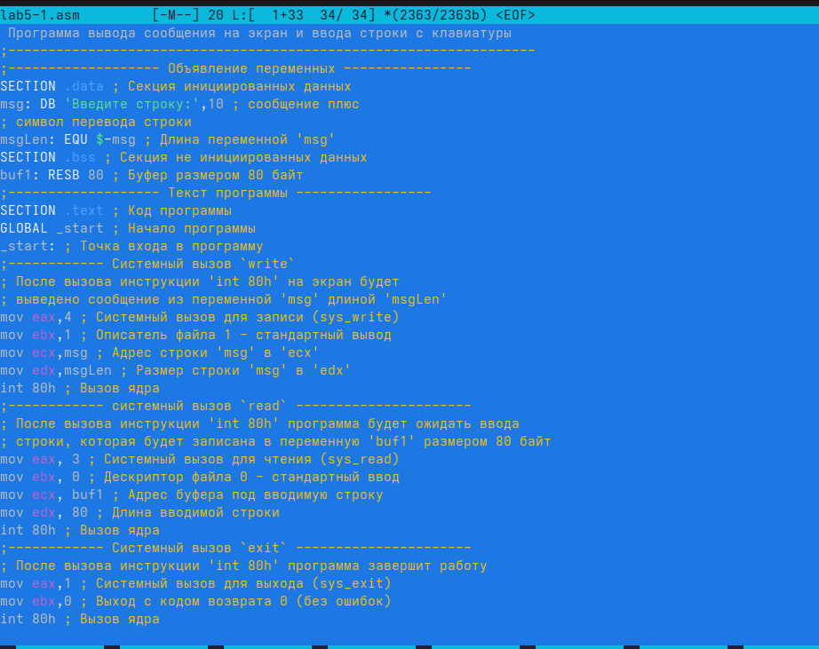
Оттранслируем текст программы lab5-1.asm в объектный файл. Выполним компоновку объектного файла и запустим получившийся исполняемый файл. Программа должна вывести строку 'Введите строку:', она будет ожидать ввода с клавиатуры. На запрос введём своё ФИО.
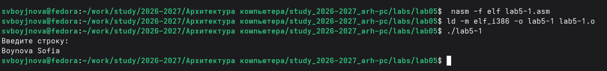
С помощью функциональной клавиши F6 создадим копию файла lab5-1.asm с именем lab5-2.asm.
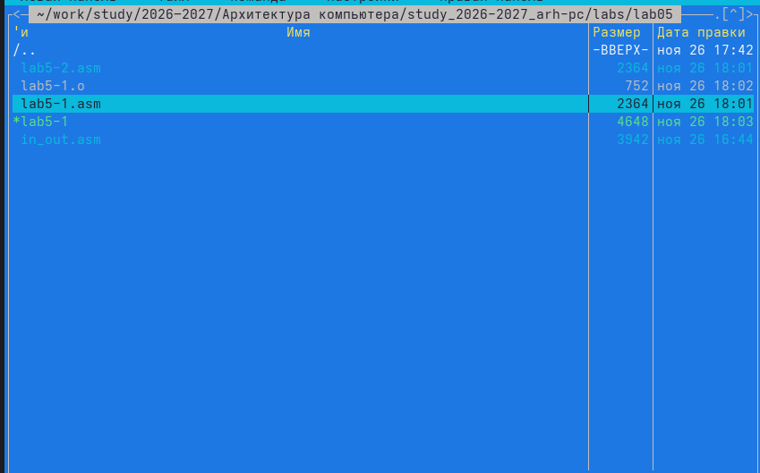
Исправив текст программы в файле lab5-2.asm с использованием подпрограмм из внешнего файла in_out.asm(скаченного из ТУИС) в соответствии с листингом 5.2.
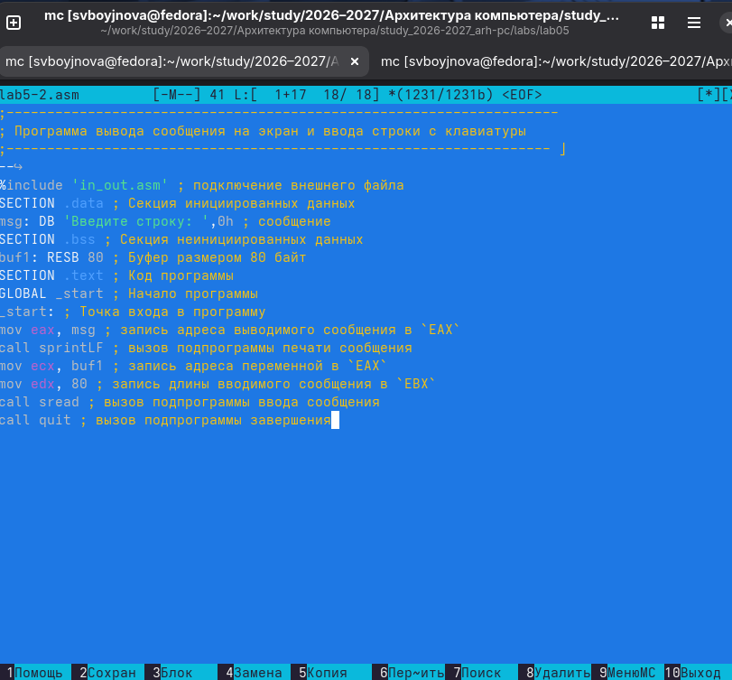
Программа проверена и работает аналогично первой версии.
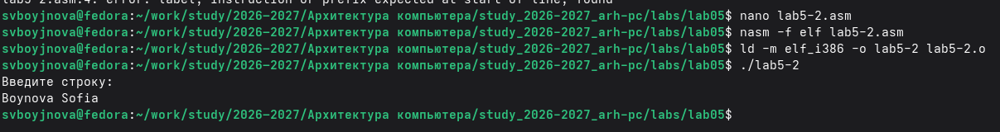
После замены подпрограммы sprintLF на sprint программа выводит сообщение «Введите строку: » без символа перевода строки, то есть приглашение и вводимая строка оказываются в одной строке экрана. Разница: sprintLF после вывода переносит на другую строку, а sprint — нет.
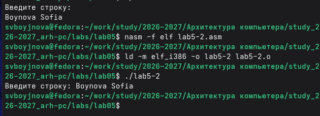
# Задание для самостоятельной работы

1. Создайте копию файла lab5-1.asm. Внесите изменения в программу (без использования внешнего файла in_out.asm), так чтобы она работала по следующему алгоритму:
— вывести приглашение типа «Введите строку: »;
— ввести строку с клавиатуры;
— вывести введённую строку на экран.
Немного изменив файл (Рис.9), запустим и проверим 
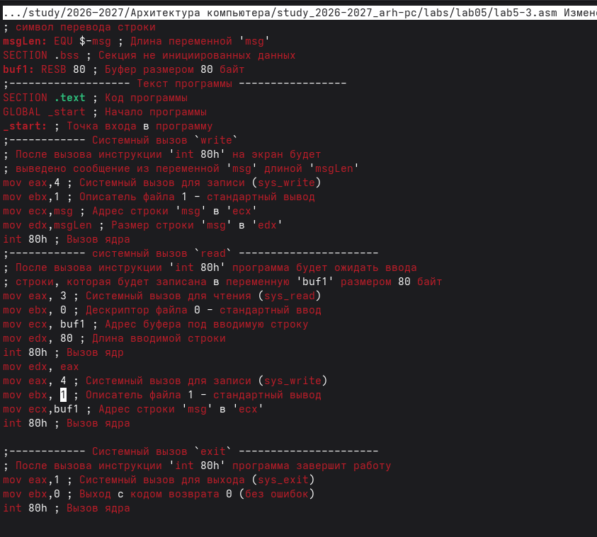
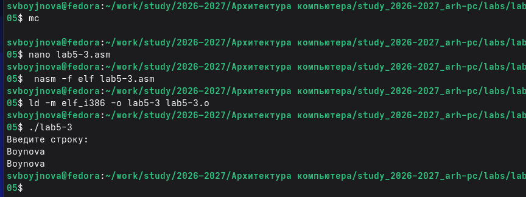
2. Создайте копию файла lab5-2.asm. Исправьте текст программы с использованием подпрограмм из внешнего файла in_out.asm, так чтобы она работала по следующему алгоритму:
— вывести приглашение типа «Введите строку: »;
— ввести строку с клавиатуры;
— вывести введённую строку на экран.
Не забудьте, подключаемый файл in_out.asm должен лежать в том же каталоге, что и файл с программой, в которой он используется.
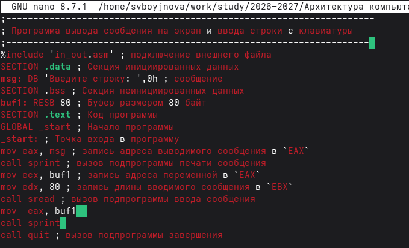
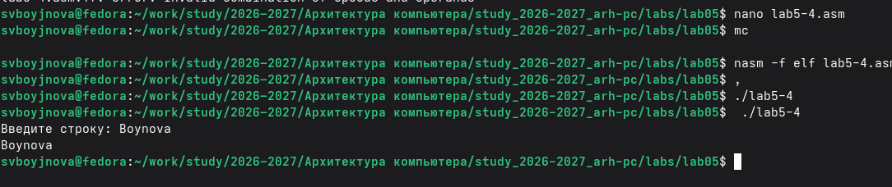
