#  Цель работы 
Целью данной работы является приобретение практических написания программ на языке ассемблера NASM с использованием арифметических операций.
#  Выполнение лабораторной работы 
## 2.1 Символьные и численные данные в NASM3.1 Символьные и численные данные в NASM
Создаю каталог для выполнения работы №6 и создаю в нем файл lab6-1.asm.
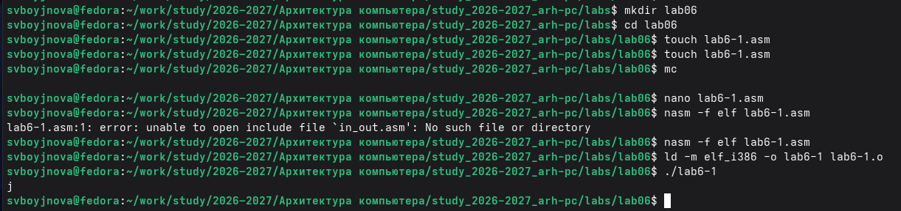
Ввела в файл lab6-1.asm текст программы из листинга 6.1.
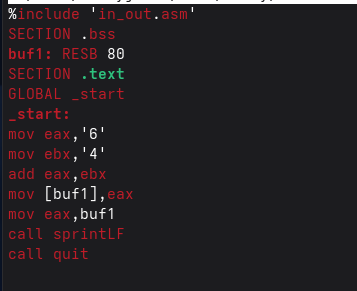
Листинг 6.2. Программа вывода значения регистра eax.
Я скопировала файл lab6-1.asm клавишей F5. Назвала его  lab6-2.asm. И переписала листинг 6.2.
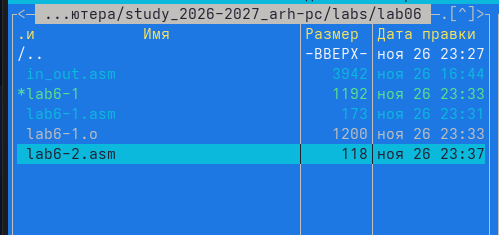
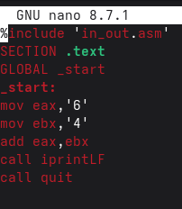

Вывод программы.
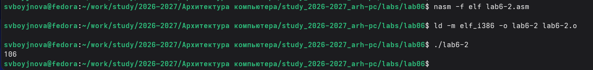

По задания я изменила символы на числа. При этом так скопировала(F5) и назвала lab6-3.
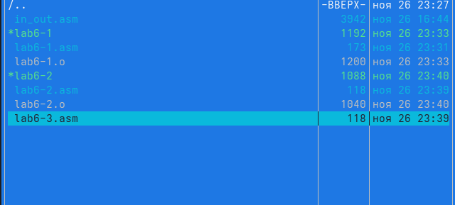

Вывод программ.
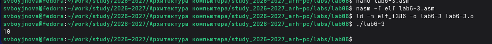
Заменив iprintLF и iprint символ не отображается.
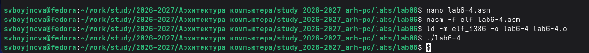

## 2.2 Выполнение арифметических операций в NASM
Листинг 6.3. Программа вычисления выражения 𝑓 (𝑥) = (5 ∗ 2 + 3)/3
Я создаю новый файл lab6-3-1.
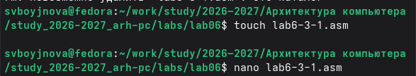
Пишу программу вычисления выражения.
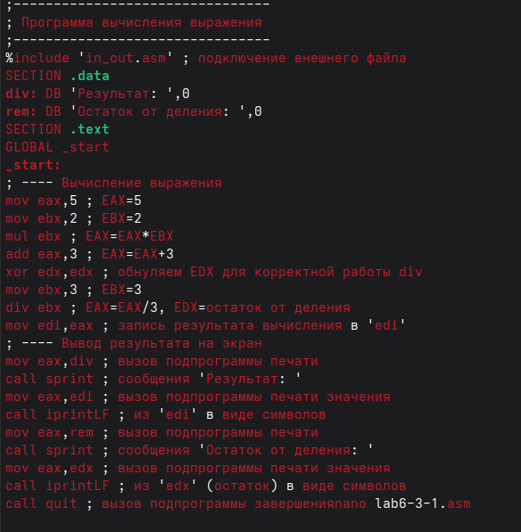
Запускаю его.
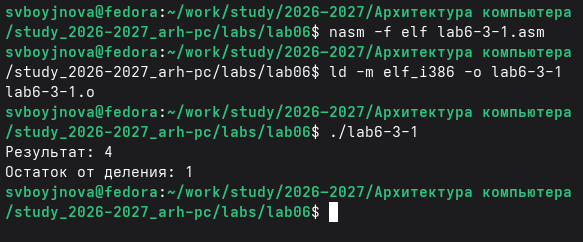
Изменила текст программы  𝑓 (𝑥) = (4 ∗ 6 + 2)/5 в файле lab6-3-1.
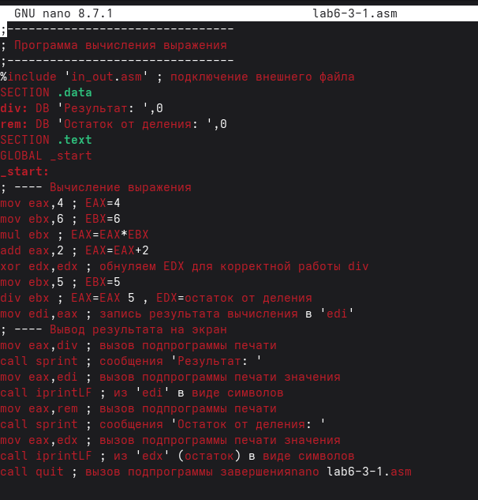
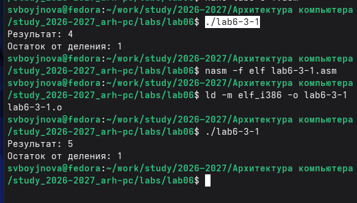
Листинг 6.4. Программа вычисления вычисления варианта задания по номеру студенческого билета
Создаю файл variant.asm в каталоге ~/work/study/2026–2027/Архитектура компьютера/study_2026-2027_arh-pc/labs/lab06. Пишу программу. Вывод.
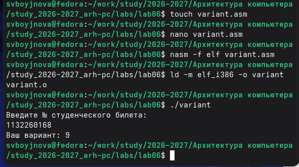
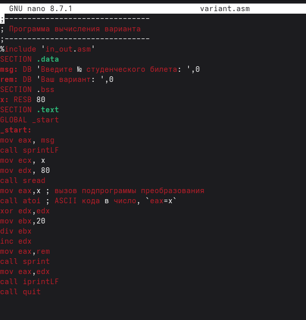

# Вопросы 
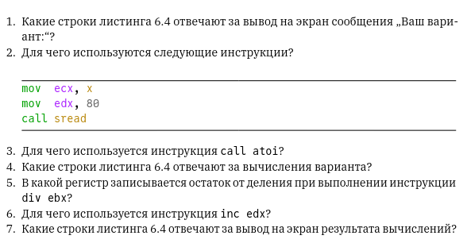

1. mov eax,rem и call sprint
2. Эти инструкции используются для ввода строки с клавиатуры. В регистр ecx записывается адрес буфера x (куда будет сохранен введенный текст). В регистр edx записывается максимальная длина вводимой строки (80 байт).  call sread вызывает подпрограмму чтения из файла in_out.asm, которая считывает символы с клавиатуры и сохраняет их в буфер x.
3. call atoi используется для преобразования строки в целое число.
4. xor edx,edx
    mov ebx,20
    div ebx
    inc edx
5. edx.
6. inc edx увеличивает остаток на 1, чтобы получить вариант от 1 до 20 (т.к. остаток от деления на 20 будет от 0 до 19).
7. mov eax,rem + call sprint (вывод сообщения) и mov eax,edx + call iprintLF (вывод номера варианта).

#  Задания для самостоятельной работы
Написать программу вычисления выражения 𝑦 = 𝑓 (𝑥). Программа должна выводить выражение для вычисления, выводить запрос на ввод значения 𝑥, вычислять заданное выражение в зависимости от введенного 𝑥, выводить результат вычислений. Вид функции 𝑓 (𝑥) выбрать из табл. 6.3 вариантов заданий в соответствии с номером, полученным при выполнении лабораторной работы. У меня вариант 9. Выражение : 10 + (31𝑥 − 5)
Создаю файл zad.asm. Пишу программу. И проверяю при х=3 и х=1.
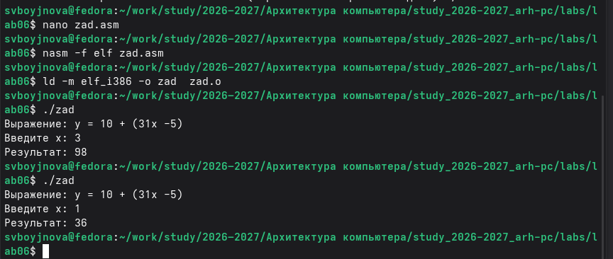
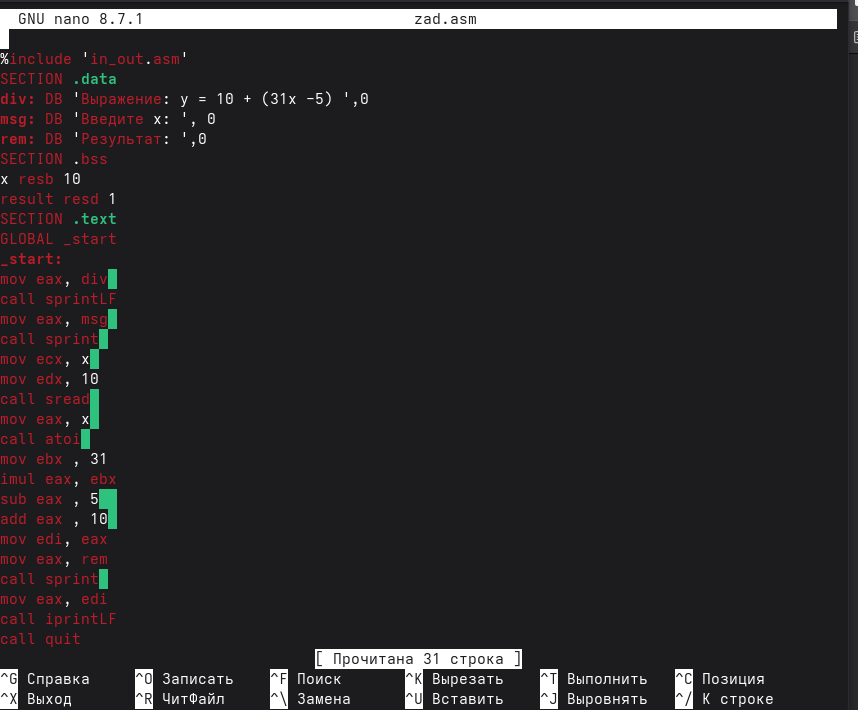

# Вывод 
В ходе лабораторной работы №6 я  освоила арифметические инструкции языка ассемблера NASM.
