# Цель работы
Целью данной работы является приобретение практических написания программ на языке ассемблера NASM с использованием команд безусловного и  условного переходов.

# Теоретическое введение
Для реализации ветвлений в ассемблере используются так называемые команды передачи управления или команды перехода. Можно выделить два типа переходов:
— условный переход – выполнение или невыполнение перехода в определенную точку программы в зависимости от проверки условия.
— безусловный переход – выполнение передачи управления в определенную точку программы без каких-либо условий. 

# Выполение лабораторной работы
## 3.1 Реализация переходов в NASM
Создаю каталог для программ лабораторной работы № 7, перехожу в него и
создаю файл lab7-1.asm.(Рис.1)
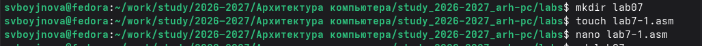
Листинг 7.1. Программа с использованием инструкции jmp
Копирую код из листинга в файл будущей программы.(Рис.2)
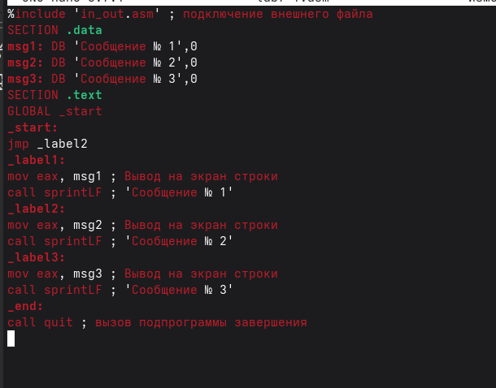
При запуске я убедился в том, что неусловный переход действительно изменяет порядок выполнения инструкций (Рис.3).

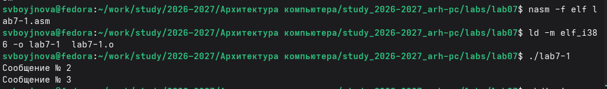

Листинг 7.2. Программа с использованием инструкции jmp
Переписываю программу и запускаю.(Рис.4)(Рис.5)
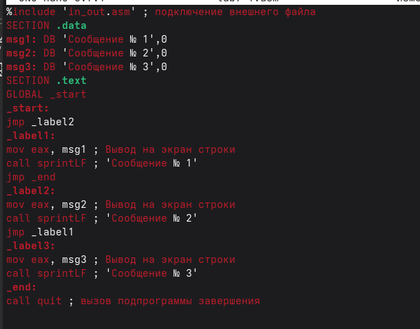

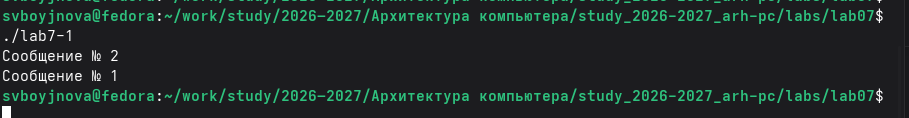

**Задание**: измените текст программы, добавив или изменив инструкции jmp, чтобы вывод программы был следующим:
user@dk4n31:~$ ./lab7-1
Сообщение № 3
Сообщение № 2
Сообщение № 1
user@dk4n31:~$
Я добавляю строчку jmp _label2 в _label3 и всё получается. (Рис.6)(Рис.7)
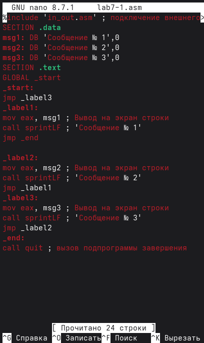

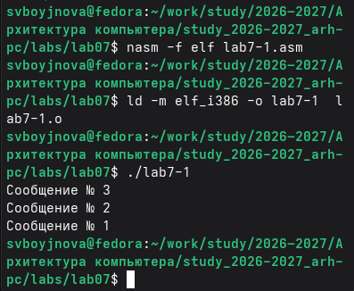

Листинг 7.3. Программа, которая определяет и выводит на экран наибольшую из трёх целочисленных переменных: A, B и C
Создаю новый файл lab7-2.asm(Рис.8) и вставляю в него код из следующего листинга (Рис.9).
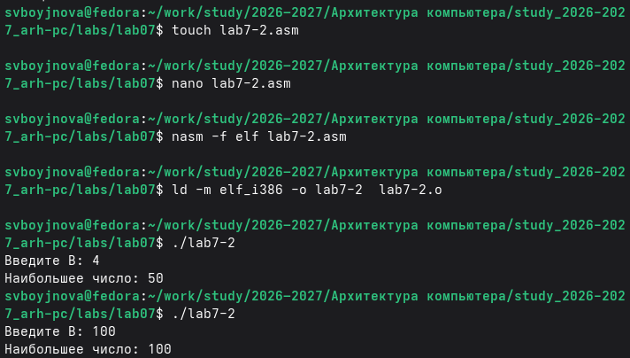

## 3.2 Изучение структуры файла листинга
Создаю файл листинга для программы из файла lab7-2.asm(Рис.10)
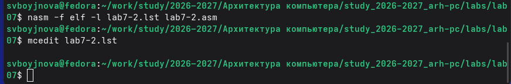

Проверяю файл листинга(Рис.11)
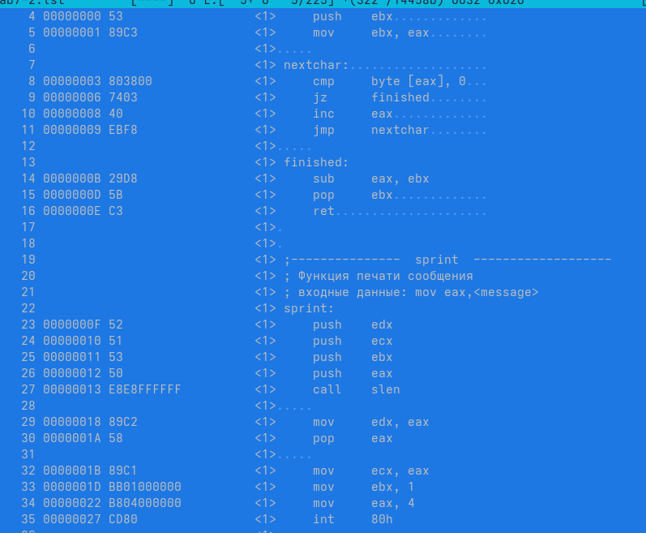

— номер строки - 9 - это номер строки файла листинга,
— адрес - 00000006 - это смещение машинного кода от начала текущего сегмента. Начинается на 6-м байте от начала сегмента кода. 
— машинный код – 7403 -  представляет собой ассемблированную исходную строку в виде шестнадцатеричной последовательности.
— исходный текст программы - jz finished - это просто строка исходной программы вместе с комментариями. Jz - проверяет флаг нуля . Если результат предыдущей операции равен нулю, происходит переход на указанную метку. Finished -  переход к завершению работы функции подсчета длины строки. 

— номер строки - 23 - это номер строки файла листинга,
— адрес – 0000000F - команда начинается по смещению 15 байт.
— машинный код – 52 -  1-байтовый машинный код.
— исходный текст программы - команда помещения значения регистра edx.  В подпрограмме sprint (печать сообщения) это делается для того, чтобы сохранить старое значение регистра edx, который будет использоваться внутри этой функции. 

— номер строки – 24  - это номер строки файла листинга,
— адрес - 00000010 - Начинается c 16-ого байта от начала сегмента кода. 
— машинный код – 51 -  1-байтовый машинный код.
— исходный текст программы -push ecx -  push — инструкция, которая помещает значение в стек. ecx — это 32-битный регистр процессора.
Удаляю один операнд и выводит ошибку.(Рис.12)(Рис.13)(Рис.14)
До: 
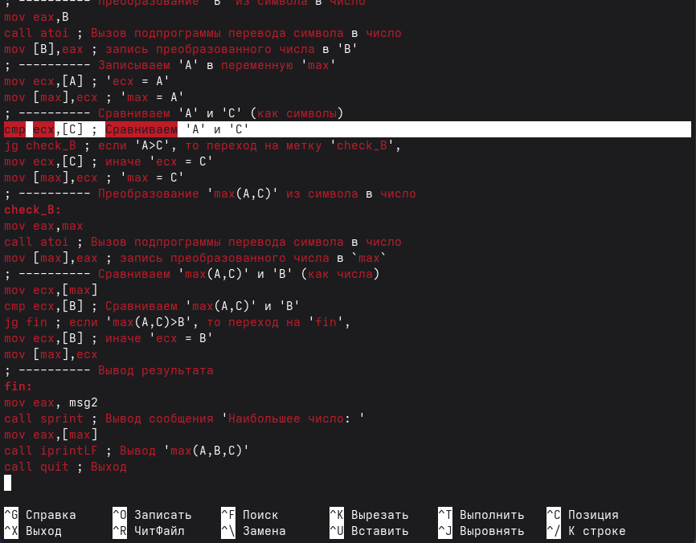

После:
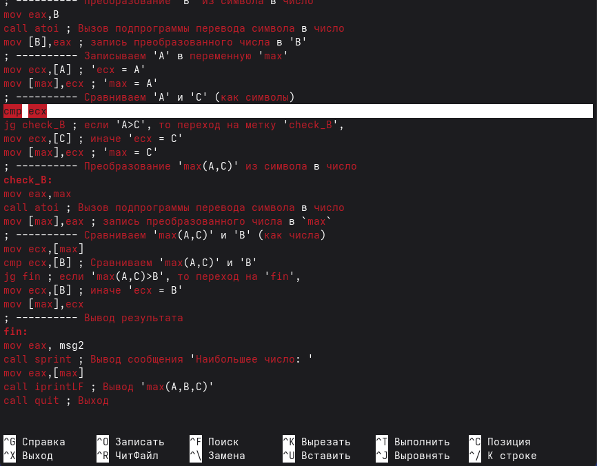
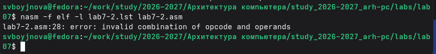

При удалении операнда возникает ошибка( error: invalid combination of opcode and operands). Листинг не создаётся. В листинг ничего не добавляется, так как процесс трансляции прерывается на этапе обнаружения ошибки
#  Задание для самостоятельной работы
1. Напишите программу нахождения наименьшей из трёх целочисленных пере-
менных 𝑎, 𝑏 и . Значения переменных выбрать из табл. 7.5 в соответствии с
вариантом, полученным при выполнении лабораторной работы № 6. Создайте
исполняемый файл и проверьте его работу.

Создаю файл для задания(Рис.15)
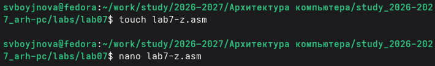

Пишу в нём програму(Рис.16) и вывожу(Рис.17)
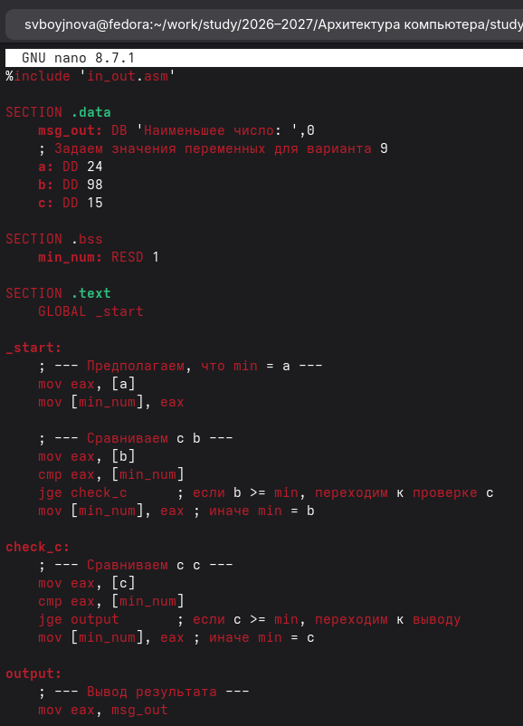
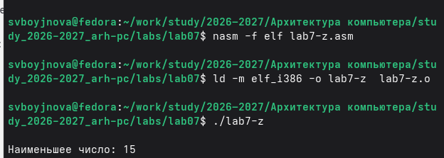

2. Напишите программу, которая для введенных с клавиатуры значений 𝑥 и 𝑎
вычисляет значение заданной функции 𝑓 (𝑥) и выводит результат вычислений.
Вид функции 𝑓 (𝑥) выбрать из табл. 7.6 вариантов заданий в соответствии с
вариантом, полученным при выполнении лабораторной работы № 6 . Создайте
исполняемый файл и проверьте его работу для значений 𝑥 и 𝑎 из табл. 7.6
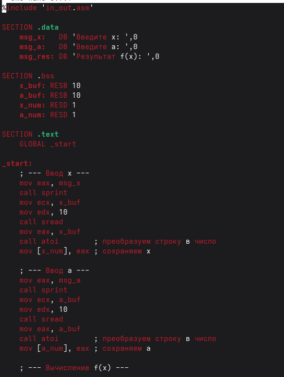
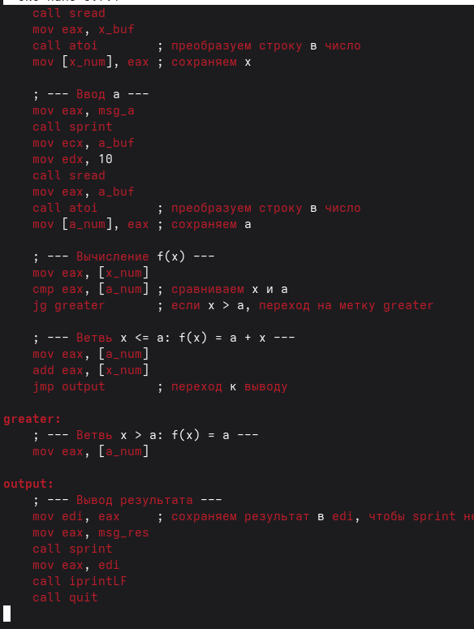
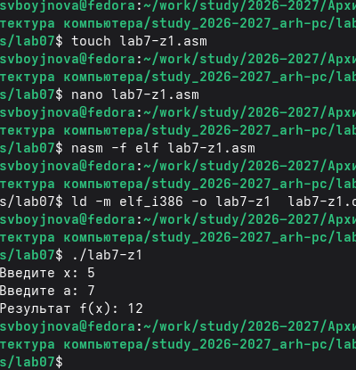

# Вывод 
При выполнении лабораторной работы я изучила команды условных и безусловных переходов, а также приобрела навыки написания программ с использованием переходов, познакомился с назначением и структурой файлов листинга.
